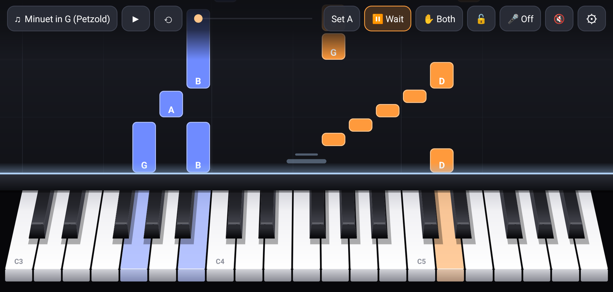
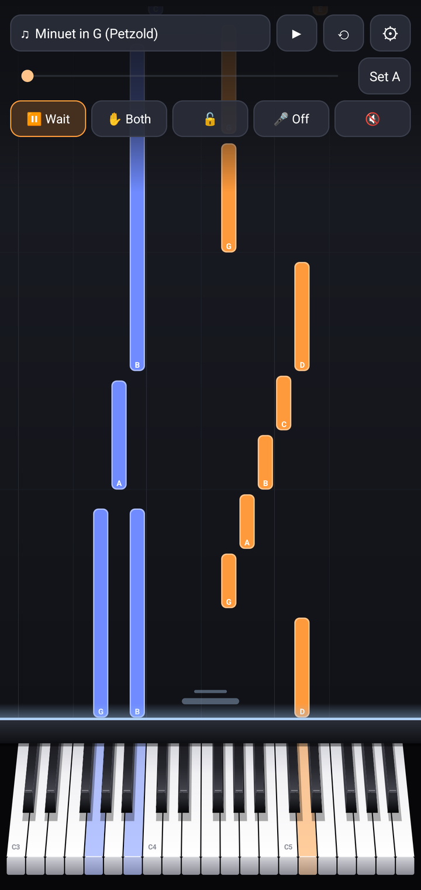
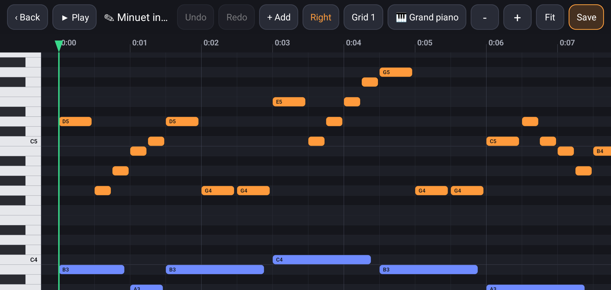
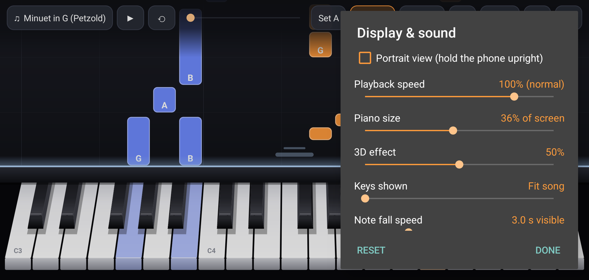

<div align="center">

# Playthrough

**Learn piano songs with falling notes on Android.**
The song waits for you to play the right key, using a MIDI keyboard, your piano's sound through the microphone, or the touch screen.

[**Download the latest APK**](https://github.com/danielwoww/Playthrough/releases/latest) · Android 8.0+ · Free and open source



</div>

## Features

- **Falling notes over a 3D keyboard.** Right hand in orange, left hand in blue, with note names on every tile.
- **Play on any piano.** Connect a MIDI keyboard over USB or Bluetooth, or let the microphone listen to an acoustic piano. Chord listening is available as an experimental mode.
- **Wait mode or Flow mode.** Wait mode pauses until you hit the right note. Flow mode keeps going and scores your accuracy.
- **Practise one hand at a time.** The app can play the other hand for you, with a choice of five instrument sounds.
- **Slow it down.** Set the speed anywhere from 5% to 125%.
- **Loop the hard parts.** Mark a section with A-B and repeat it until it sticks.
- **Scroll and zoom by touch.** Drag the notes to move through the song, and pinch to resize the keyboard or change the fall speed.
- **Landscape or portrait.** Practise with the phone on its side or upright on the music stand.
- **Import any MIDI file**, or open one straight from your file manager.
- **Built-in MIDI editor.** Make simpler practice versions of songs, or write your own.

## Screenshots

<table>
  <tr>
    <td rowspan="2" align="center"><br><sub>Portrait view</sub></td>
    <td align="center"><br><sub>MIDI editor</sub></td>
  </tr>
  <tr>
    <td align="center"><br><sub>Display and sound settings</sub></td>
  </tr>
</table>

## Install

1. Download `Playthrough-vX.Y.Z.apk` from the [latest release](https://github.com/danielwoww/Playthrough/releases/latest) on your phone.
2. Open it. Android will ask you to allow installs from your browser or file manager the first time.

Every release is built from this repository by [GitHub Actions](.github/workflows/release.yml) and signed with the same key. The release notes list the APK's SHA-256 checksum and the signing certificate fingerprint. You can also confirm that an APK came from this repository with the [GitHub CLI](https://cli.github.com/):

```
gh attestation verify Playthrough-v1.0.0.apk --repo danielwoww/Playthrough
```

## Using it

- **Pick a song** from the song menu. A few public-domain pieces are built in: Twinkle Twinkle, Ode to Joy, Minuet in G and the opening of Für Elise.
- **Choose your input** in the top bar: a MIDI keyboard is picked up automatically, 🎤 turns on the microphone, and the on-screen keys always work.
- **Adjust the view** under ⚙: piano size, 3D effect, number of keys, fall speed and labels. Tap 🔓 to lock the view so gestures can't change it.
- **Edit a song** from the song menu with **✎ Edit** or **＋ New empty song**. Edits are saved as a new song, so the original stays intact.

## Building from source

Requires JDK 17 and the Android SDK.

```
./gradlew assembleDebug
```

The APK is written to `app/build/outputs/apk/debug/`. Run the unit tests with `./gradlew testDebugUnitTest`.

## License

Released under the [MIT License](LICENSE).
